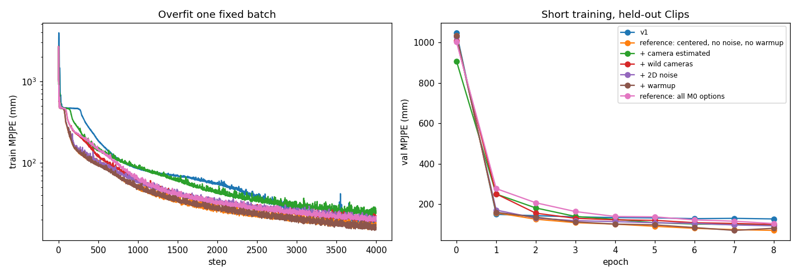

# M0 local training check (#9)

`scripts/m0_local_check.py`, run locally (RTX 3050 Ti), on the first 60 template-shape AMASS training Clips (48 train, 12 held out). The shaped set (#2) wasn't generated yet; body shape doesn't affect this check.

1. **Overfit**: one fixed batch of 64 Windows, 4000 steps, then the error in eval mode.
2. **Short training**: 8 epochs × 300 batches with new cameras each epoch, MPJPE on the 12 held-out Clips. The reference variants use the Masking mode in the name (full priors otherwise).

| Variant | Overfit: first → final MPJPE (mm) | Val MPJPE epoch 0 → 1 → last (mm) |
|---|---|---|
| v1 | 1041 → 20.0 | 1049 → 149 → 126.7 |
| reference: centered, no noise, no warmup | 1046 → 10.2 | 1035 → 157 → 70.2 |
| + camera estimated | 923 → 18.1 | 908 → 250 → 97.2 |
| + wild cameras | 999 → 15.0 | 1010 → 251 → 99.4 |
| + 2D noise | 1039 → 12.6 | 1027 → 171 → 92.8 |
| + warmup | 1043 → 11.9 | 1035 → 159 → 80.4 |
| reference: all M0 options | 994 → 13.4 | 1003 → 277 → 103.8 |

**Verdict: training is valid.** Every variant overfits the fixed batch to 10–20 mm (v1: 20 mm) and every held-out curve falls steadily. The harder variants (camera estimated, wild cameras, all M0 options) start higher and fall more slowly, as expected from harder inputs. No option breaks training.

v1 errors are in the Clip pelvis frame and the reference errors in the camera frame. On the same Clips, v1 levels off around 127 mm while the reference model without the new options reaches 70 mm. That is consistent with the pelvis-frame target being partly ambiguous mid-Clip, but these are small runs, so treat it as a hint, not a result.
