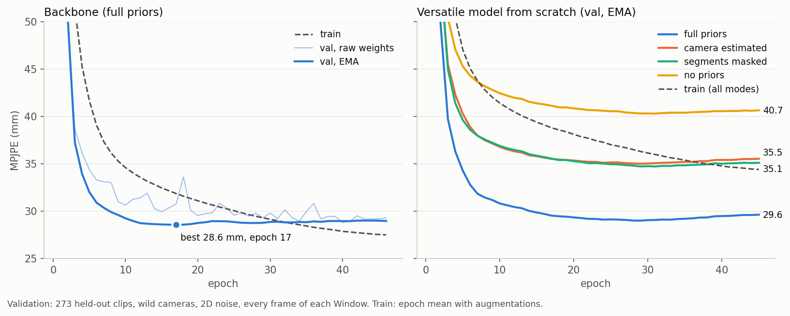
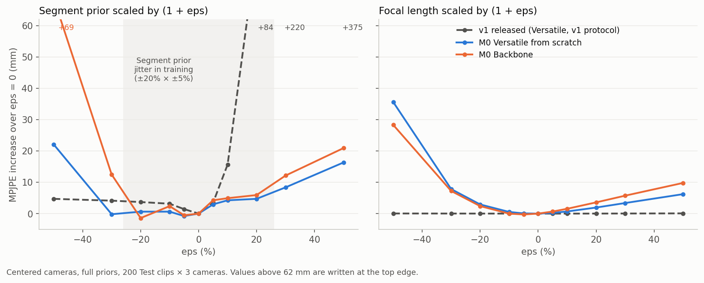

# Research reference model (M0): first analysis

Checkpoints: `best.pt` (EMA weights) of the two Jean Zay runs, pulled on 2026-11-02 near the end of training. Backbone: best epoch 17 of 50. Versatile model from scratch: best epoch 29 of 50. Both use the generation 2 recipe:
- OneCycle learning rate, peak 3e-4
- EMA 0.9999
- Segment prior jitter on half the Windows: ±20% global × ±5% per segment
- wild cameras, 2D noise and Sliding window warmup in training

Evaluation was run locally with evaluation protocol v2 on all 800 Test clips, with **3 cameras per Clip** instead of the 10 of the official run, which is still queued on Jean Zay. The headline is newest-frame MPJPE: each frame is lifted as the newest frame of its Window, as in a live session.

Files:
- `versatile_scratch.{json,md}`, `backbone.{json,md}`: full results
- `v1_versatile_epoch12_sweep.{json,md}`: the v1 sweep
- `learning_curves.png`, `prior_sweep.png`

## 1. Training

- **Both runs reach their best validation early.** The Backbone is best at epoch 17 (28.6 mm) and the Versatile model at epoch 29 (29.0 mm). After that, training error keeps falling but validation slowly rises, by +0.4 and +0.6 mm. The 0.5M-parameter model is limited by the 5,179 training Clips, not by training time. 20–25 epochs would give the same checkpoints.
- **EMA weights give a better checkpoint earlier** than the raw weights (1–2 mm in the first half of training). The two meet once the learning rate has annealed.

## 2. Test results

Newest-frame MPJPE (mm), all 800 Test clips, mean ± std over Clips:

| Model | Camera setting | full priors | camera estimated | segments masked | no priors |
|---|---|---|---|---|---|
| Backbone | centered | **31.9** ± 10.8 | | | |
| Versatile from scratch | centered | 32.8 ± 11.0 | 37.5 ± 10.3 | 37.4 ± 13.0 | 41.9 ± 12.1 |
| Backbone | wild | **29.0** ± 10.2 | | | |
| Versatile from scratch | wild | 29.3 ± 10.1 | 35.1 ± 11.0 | 34.7 ± 12.6 | 40.3 ± 13.1 |

For context, v1 (released Versatile model, epoch 12, v1 protocol) scores 39.3 / 40.4 / 43.4 / 44.6 mm. **This is not a like-for-like comparison:**

| | v1 | M0 |
|---|---|---|
| Body shapes | 2 templates | real AMASS body shapes |
| 2D input | exact projections | noisy 2D (jitter, outliers, swaps, missing keypoints) |
| Frames scored | every frame, averaging overlapping Windows (sees the future) | newest frame only |
| Targets | pelvis frame of the Clip's first frame | camera frame |

M0's task is harder, except for the camera-frame targets, which remove an error v1 could not avoid. On v1's own frame averaging, M0 Versatile scores 29.6 mm (centered).

**What the numbers show:**
- **Versatility is almost free.** With full priors, the Versatile model is within 0.3–0.9 mm of the Backbone.
- **The priors matter more than in v1.** Extra error when masking each prior (all Clips):

  | Masked | v1 | M0, centered | M0, wild |
  |---|---|---|---|
  | Camera prior | +1.1 mm | +4.7 mm | +5.8 mm |
  | Segment prior | +4.1 mm | +4.6 mm | +5.4 mm |
  | Both | +5.3 mm | +9.1 mm | +11.0 mm |

- **The Segment prior fixes scale.** Without it, the scale-free N-MPJPE rises less than MPJPE (+2.8 vs +4.6 mm), and the bone-length error rises from 12.9 to 16.3 mm.
- **Without the true focal length, the errors are mostly in the legs.** In camera estimated mode the ankles get +16 mm and the knees +6 mm, while the upper body changes by 1–3 mm. That fits a depth and foreshortening error.
- **Warmup is short.** With 4–5 frames of history, the error is already within about 3 mm of a full Window.
- **Size and speed:** 533,379 parameters. `benchmark.py` (one Window, batch 1) gives 2.2 ms on CPU (i7-11800H) and 1.1 ms on GPU (RTX 3050 Ti laptop). v1 takes 1.7 / 0.8 ms on the same machine; the two prior tokens and the attention mask add about 30%.
- **Wild cameras score lower than centered ones** (29.3 vs 32.8 mm). The wild setting includes closer, wider-angle views, where perspective gives more depth cues. This is a hypothesis we haven't checked.

## 3. Sensitivity to wrong priors (Hu Yan's test)

Same protocol as Hu Yan, on 200 evenly spaced Test clips × 3 cameras, with full priors. The Segment prior is scaled by (1 + eps), or the focal length used to normalize the 2D input is scaled by (1 + eps).

**First, our sweep reproduces Hu Yan's v1 result** (released Versatile, v1 protocol):

| | v1 slope eps > 0 (mm per unit eps) | v1 slope eps < 0 | Asymmetry |
|---|---|---|---|
| Hu Yan (265 Clips, 25 eps values) | +787 | 8.6 | about 90× |
| This sweep (200 Clips, 11 eps values) | +693 ± 5 | 12.0 ± 0.7 | about 58× |

Focal length ±50% changes v1's error by about 0.1 mm in both measurements. Our bone ratio confirms his mechanism:
- With a too-short prior, v1 ignores it: the predicted lengths stay at 1.00 × the truth.
- With a too-long prior, v1 doesn't follow it; it breaks: predicted lengths 0.54 × at +30% and 0.10 × at +50%.

**M0 Versatile from scratch**, centered cameras. Extra error (mm) over eps = 0:

| Segment prior scaled by | −50% | −30% | −10% | +5% | +10% | +20% | +30% | +50% |
|---|---|---|---|---|---|---|---|---|
| v1 | +4.7 | +4.1 | +3.1 | +3.5 | +15.6 | +84.0 | +219.7 | +374.7 |
| M0 Versatile | +22.1 | −0.2 | +0.6 | +3.0 | +4.3 | +4.7 | +8.4 | +16.3 |
| M0 Backbone | +68.8 | +12.5 | +2.4 | +4.3 | +5.0 | +6.0 | +12.2 | +21.0 |

| M0 Versatile slopes (mm per unit eps) | eps > 0 | eps < 0 |
|---|---|---|
| Segment prior, centered | +31 ± 1 | −28 ± 1 |
| Segment prior, wild | +41 ± 1 | −81 ± 2 |
| Focal length, centered | +12 ± 0.4 | −53 ± 2 |
| Focal length, wild | +13 ± 1 | −44 ± 2 |

Negative slopes on the eps < 0 side mean the error grows as the prior shrinks.

- **A too-long Segment prior no longer makes the model collapse.** The positive slope drops from +693 to +31 mm per unit eps (22× smaller). At +30%, the error rises by 8 mm instead of 220 mm.
- **The asymmetry is gone.** Within about ±30% the response is flat and nearly symmetric. That covers what the training jitter spans (±20% × ±5%, so up to ±26%).
- **Outside the trained range, the model fails again,** this time on the negative side: +22 mm at −50% for the Versatile model, +69 mm for the Backbone. This matches Hu Yan's caveat: jitter protects only the range it covers. If priors from real users can be off by more than about 25%, train with a wider range.
- **The model treats the Segment prior as a hint, not a rule.** The follow score is 0.10–0.45: the predicted lengths move by only a fraction of the change in the prior. Even so, the true prior is worth about 4.6 mm (section 2). This is the "graded confidence" that Hu Yan's intervention model lacked: his model switched between using the prior and ignoring it.
- **The Versatile model is more robust than the Backbone.** It has learned to work without the prior (segments masked mode), so a wrong prior costs it less.
- **The focal length now matters.** v1 ignored it; M0 uses it, because its 2D input is normalized by the focal length. A focal length that is 20% too short costs +2.9 mm, and 50% too short costs +36 mm. A focal length that is too long costs much less: +6 mm at +50%. In practice:
  - If the phone's intrinsics are known (they almost always are), pass them.
  - If they aren't, camera estimated mode (37.5 mm) beats a guess that is off by more than about 30%.
- **The predictions are slightly too long** (bone ratio 1.03 at eps = 0), and scaling the prior down by 5–20% lowers the error by about 1 mm. One likely cause is the two non-rigid Segment prior pairs (shoulder width, shoulder–hip), measured on one frame. The Segment prior v2 of M2, built on rigid skeleton bones, should remove this.

## Caveats

- **3 cameras per Clip:** expect a few tenths of a mm of difference from the official 10-camera evaluation.
- **No control run without jitter.** The run without prior noise wasn't trained (no free GPU slot), so the robustness can't be attributed to the jitter alone. Real body shapes in the data may also teach the model not to trust the prior blindly. Hu Yan's own intervention, on v1 with jitter as the only change, suggests jitter is the main factor.
- **The v1 sweep uses the v1 protocol** (exact 2D, every frame averaged). Slopes in mm per unit eps are comparable; absolute errors are not.
- **The Versatile model fine-tuned from the Backbone is still training.** It may beat the from-scratch model.

## 4. Bone-stretching test (#11)

`bone_stretching.{json,md}`: the Versatile model's full_priors predictions, with each Segment prior bone stretched to the prior's length. The stretched bones are the 2 forearms and 2 thighs, plus shoulder width, stretched about the mid-shoulder. Each bone keeps its predicted direction, and the joints below it move with it. No training is involved. All 800 Test clips, 3 cameras.

| Newest-frame (mm) | centered: raw | centered: stretched | wild: raw | wild: stretched |
|---|---|---|---|---|
| MPJPE | 32.8 | **29.8** | 29.3 | **26.6** |
| N-MPJPE | 28.4 | 28.5 | 25.4 | 25.5 |
| PA-MPJPE | 23.1 | 22.9 | 20.5 | 20.2 |
| Bone-length error | 12.9 | 7.8 | 11.8 | 7.0 |
| Knees / ankles | 29.6 / 48.4 | 24.9 / 42.5 | 26.4 / 43.6 | 22.1 / 38.7 |
| Wrists | 47.7 | 44.0 | 42.2 | 38.5 |

- **Imposing the given lengths cuts MPJPE by 3 mm (9%).** The model only half-uses the Segment prior (follow 0.10–0.45, section 3); using it through the skeleton makes it use the prior fully.
- **The whole gain is scale.** N-MPJPE doesn't change, so the predicted directions are as good as before, and the stretch fixes their length. This is the gain that the forward-kinematics design of M2 targets (hypothesis H3).
- **Only 5 of the 12 tree bones are stretched,** because the v1 Segment prior has no upper arms, shanks or hip width. Segment prior v2 (all tree bones) should give more.
- **Caveat:** this uses exact lengths. Forward kinematics trusts the prior completely, so a wrong prior will cost more than it costs the current model (section 3). M2 should be evaluated with the prior perturbation sweep, and keep a predicted-length path for when the prior is masked.
